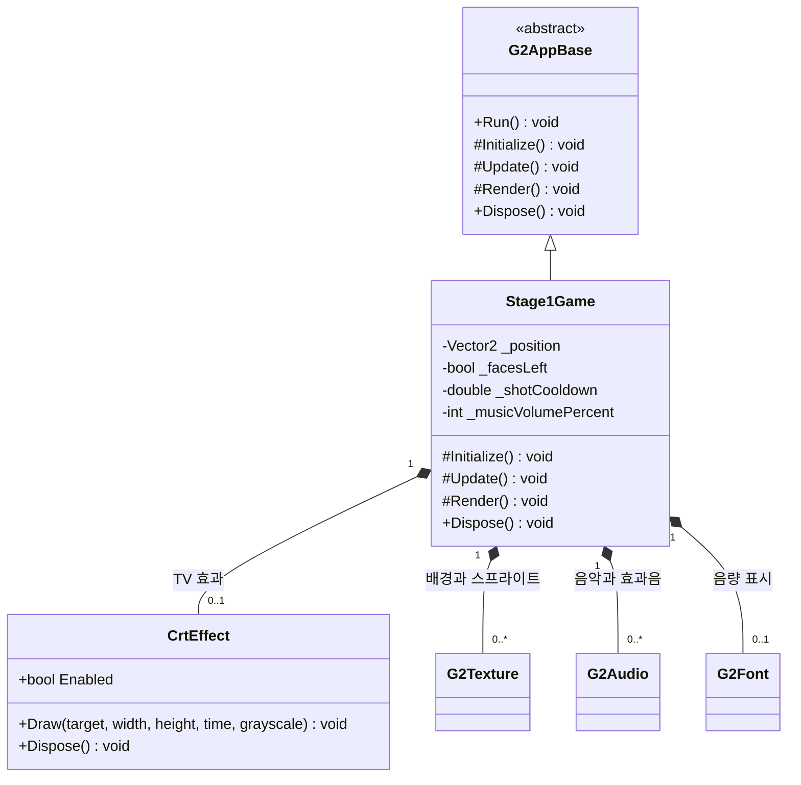
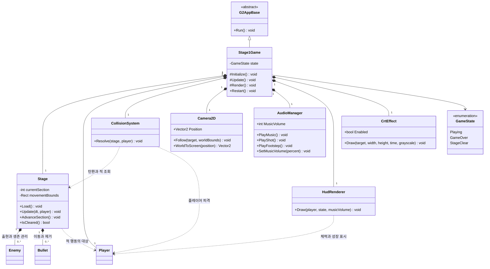
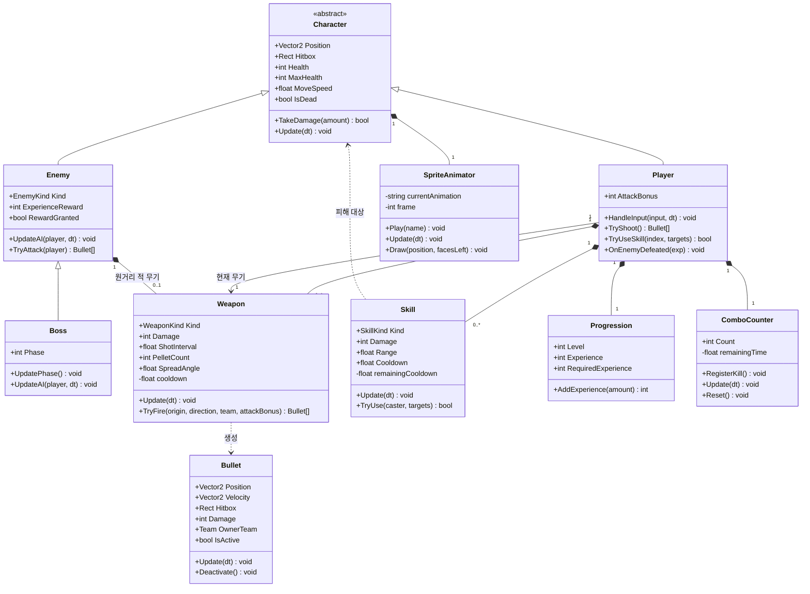

# ONE SHOT ONE KILL 게임 설계 및 UML 클래스 다이어그램

- 작성일: 2026-10-28
- 기준: [게임 기획서](기획서.md), 현재 `Program.cs`와 `CrtEffect.cs`
- 목적: 현재 프로토타입을 적과 싸우고 스테이지를 클리어하는 게임으로 발전시키기 위한 설계
- 아래 목표 설계는 제안이며, 클래스와 게임 규칙이 모두 구현되어 있다는 뜻은 아닙니다.

## 1. 게임을 구체화한 설계안

### 기본 플레이

1920~30년대 미국의 가상 도시에서 마피아 조직원들을 상대하는 2D 횡스크롤 액션 슈팅 게임입니다. 화면 안에서는 상하좌우로 이동하고, 스테이지 진행 방향은 오른쪽입니다. 현재 도로 배경 프로토타입을 출발점으로 삼고, 기획상의 재즈 클럽 홀과 주방을 순서대로 구현합니다.

플레이 흐름은 **이동 → 적 무리와 전투 → 적 처치와 경험치 획득 → 다음 구역 → 보스 → 클리어**로 구성합니다. 플레이어 체력이 0이 되면 게임 오버가 되고, 재시작하면 스테이지와 플레이어 상태를 초기화합니다.

### 전투 규칙

| 요소 | 설계 |
|---|---|
| 이동 | 방향키 4방향 이동, 대각선 속도 보정, 이동 가능 영역 제한 |
| 기본 공격 | Z키 연사, 바라보는 방향으로 사격, 탄약 제한 없음 |
| 사격과 이동 | 현재 동작을 유지하여 사격 중 및 사격 애니메이션 종료 전 이동 제한 |
| 명중 | 탄환과 대상의 충돌 영역이 겹치면 피해 적용. 위아래 위치가 다른 적은 빗나갈 수 있음 |
| 탄환 | 기본적으로 첫 대상에 명중하면 소멸. 발사자와 같은 진영에는 피해를 주지 않음 |
| 피격 | 체력 감소, 짧은 무적 시간으로 순간적인 중복 피해 방지 |
| 처치 | 적의 체력이 0이 되면 한 번만 경험치와 콤보를 지급하고 사망 연출 후 제거 |
| 콤보 | 제한 시간 안에 다음 적을 처치하면 증가, 시간이 지나거나 플레이어가 피해를 받으면 초기화 |
| 성장 | 경험치 기준을 넘으면 레벨 상승. 초기 버전에서는 공격력과 최대 체력을 자동 증가 |
| 스킬 | 범위 공격과 단일 대상 강공격을 구분하며 각각 재사용 대기시간 적용 |

체력, 피해량, 무적 시간, 콤보 유지 시간, 경험치 요구량과 스킬 조작키는 플레이 테스트 후 확정합니다. 현재 기본 연사 간격은 0.2초입니다. 게임 제목은 모든 적이 반드시 한 발에 죽는다는 규칙으로 해석하지 않습니다.

### 적과 무기

- 일반 조직원: 플레이어에게 접근하여 근접 공격합니다.
- 경호원: 체력이 높고 접근해서 공격합니다.
- 원거리 조직원: 일정 거리를 유지하며 탄환을 발사합니다.
- 클럽 보스: 일반 적의 체력·피격 구조를 재사용하고, 체력 구간에 따라 공격 패턴을 변경합니다.
- 권총·산탄총·토미건: 공통 `Weapon` 클래스의 피해량, 연사 간격, 탄환 수, 퍼짐 값을 다르게 설정합니다. 초기에는 무기별 상속 클래스를 만들지 않습니다.

### 1스테이지 구성

1. 클럽 진입 구간에서 이동과 사격을 익힙니다.
2. 홀과 주방 구역에서 일반 조직원, 경호원, 원거리 적을 차례로 상대합니다.
3. 각 구역의 적을 모두 처치하면 다음 구역으로 진행합니다.
4. 마지막 구역에서 보스를 처치하면 스테이지 클리어 상태로 전환합니다.

현재 고정 화면을 먼저 전투 가능한 상태로 완성한 뒤, 월드 좌표와 카메라를 도입해 횡스크롤 구간을 연결합니다.

## 2. 현재 구현 구조

현재는 `Stage1Game`이 이동, 사격, 탄환 목록, 애니메이션, 사운드와 배경을 직접 처리합니다. `Player`, `Enemy`, `Weapon`, `Bullet` 같은 독립 클래스는 아직 없습니다. 탄환은 위치와 방향을 저장하는 튜플 목록입니다.

초기화 전에는 리소스가 없을 수 있어 현재 구조의 리소스 개수를 `0..1`, `0..*`로 표기했습니다. 프레임워크 내부의 그래픽·입력·오디오 구성은 생략했습니다.

## 3. 목표 UML 클래스 다이어그램

읽기 쉽도록 같은 설계를 전체 구조와 전투 상세로 나누었습니다. 아래 다이어그램에서 동일한 이름은 동일한 클래스를 뜻합니다. 기존 클래스는 `G2AppBase`, `Stage1Game`, `CrtEffect`이며, 나머지는 새로 분리하거나 추가할 클래스입니다. 기존 클래스의 아래 역할과 메서드도 목표 설계 기준입니다.

### 전체 구조

`Stage`는 배경, 이동 가능 영역, 구역별 적 출현 정보도 관리합니다. 까마귀 같은 배경 연출은 우선 이 클래스에 포함합니다. `Camera2D`는 화면 좌표 변환만 담당하며 충돌 판정은 월드 좌표로 수행합니다. 목표 구조의 소유 관계는 게임 초기화가 완료된 시점을 기준으로 표시했습니다.

### 캐릭터·전투·성장 상세

열거형 값은 다음처럼 정의합니다.

| 타입 | 값 |
|---|---|
| `Team` | Player, Enemy |
| `EnemyKind` | Gangster, Guard, Gunner, Boss |
| `WeaponKind` | Pistol, Shotgun, TommyGun |
| `SkillKind` | AreaAttack, PowerAttack |

플레이어의 현재 무기는 보유한 무기 중 하나를 참조합니다. `Boss`도 `Enemy`이므로 별도 보스 목록 없이 스테이지의 적 목록에 포함합니다. `Weapon.TryFire()`가 만든 탄환은 호출자가 `Stage`에 등록하며, 이후 수명은 `Stage`가 관리합니다. 스킬은 초기 설계에서 즉시 범위 또는 단일 대상 피해를 적용합니다.

## 4. 클래스별 책임과 현재 코드 연결

| 클래스 | 담당 역할 | 현재 코드에서 옮기거나 추가할 내용 |
|---|---|---|
| `Stage1Game` | 게임 상태 및 프레임 처리 순서 조정 | 기존 클래스 유지, 세부 로직 위임 |
| `Stage` | 배경, 이동 영역, 구역, 적·탄환 목록 | 배경·까마귀·탄환 목록 분리, 구역과 적 관리 추가 |
| `Character` | 위치, 충돌 영역, 체력, 피격 공통 처리 | 새로 추가 |
| `Player` | 입력 이동, 공격 요청, 보상 반영 | `_position`, `_facesLeft`, 이동·사격 제한 분리 |
| `Enemy` / `Boss` | 일반 적 행동 / 보스 패턴 | 새로 추가 |
| `Weapon` | 무기 설정, 연사 간격, 탄환 생성 | `_shotCooldown`, 발사 처리 분리 |
| `Bullet` | 개별 탄환 이동과 유효 상태 | 현재 탄환 튜플을 클래스로 전환 |
| `CollisionSystem` | 진영·명중 확인, 피해, 처치 보상 전달 | 새로 추가 |
| `SpriteAnimator` | 대기·걷기·사격·피격·사망 애니메이션 | 프레임 계산과 캐릭터 그리기 분리, 피격·사망 추가 |
| `Skill` | 스킬 효과와 재사용 대기시간 | 새로 추가 |
| `Progression` | 경험치와 레벨 계산 | 새로 추가, 상승 레벨 수를 반환하고 Player가 능력치 반영 |
| `ComboCounter` | 연속 처치 수와 제한 시간 | 새로 추가 |
| `Camera2D` | 횡스크롤 추적과 좌표 변환 | 새로 추가 |
| `AudioManager` | 배경음악, 총성, 발소리, 음량 | 기존 오디오 필드와 재생 코드 분리 |
| `HudRenderer` | 체력, 경험치, 콤보, 음량 표시 | 기존 음량 표시 분리 및 전투 정보 추가 |
| `CrtEffect` | 브라운관 연출 | 기존 클래스 재사용 |

흑백 전환은 기존 `G2AppBase.GrayscaleEnabled`를 사용합니다. 렌더링은 월드 객체 → 화면 효과 → HUD 순서로 처리합니다. 텍스처·오디오 자원을 소유하는 클래스는 `Dispose()`로 자원을 해제하도록 구현하되, 다이어그램에서는 반복되는 해제 메서드를 생략했습니다.

## 5. 한 프레임의 처리 예시

1. `Stage1Game`이 입력과 게임 상태를 확인합니다. 게임 오버·클리어 상태에서는 전투 갱신을 멈춥니다.
2. 플레이어와 적의 무기·스킬 대기시간을 갱신하고, 이동과 공격 요청을 처리합니다.
3. 무기가 생성한 탄환을 `Stage`에 등록하고 탄환을 이동시킵니다.
4. `CollisionSystem`이 반대 진영의 살아 있는 대상과 충돌하는지 검사합니다.
5. `TakeDamage()`가 실제 피해 적용 여부를 반환합니다. 유효한 대상에 충돌한 기본 탄환은 무적 여부와 관계없이 소멸합니다.
6. 적이 처음 사망하면 `RewardGranted`를 설정하고 `Player.OnEnemyDefeated()`를 한 번 호출합니다. 스킬 처치도 같은 보상 처리 경로를 사용합니다.
7. 플레이어가 피해를 받았다면 콤보를 초기화합니다. 사망 시 게임 오버를 우선 적용하고, 살아 있다면 구역 진행과 보스 처치에 따른 클리어를 확인합니다.
8. 비활성 탄환과 사망 연출을 끝낸 적을 제거하고 화면을 그립니다.

## 6. 구현 순서

1. **현재 동작 분리:** Player, Weapon, Bullet, SpriteAnimator, AudioManager를 추출합니다. 이동·사격·연출을 유지합니다.
2. **전투 최소 완성:** Character, Enemy, CollisionSystem을 추가하여 적 한 종류의 접근·공격·피격·사망과 게임 오버·재시작을 구현합니다.
3. **스테이지 완성:** Stage의 구역 진행, Camera2D, 원거리 적, 경호원, Boss와 클리어를 구현합니다.
4. **전투 확장:** 무기 변경, Skill, Progression, ComboCounter와 HUD를 추가합니다.

이 문서는 목표 구조를 정리한 설계 문서이며, 게임 소스코드에는 아직 위 분리 및 신규 기능을 적용하지 않았습니다.

## UML 표기 읽는 법

- `+`: public, `-`: private, `#`: protected
- 속이 빈 삼각형 화살표: 상속 관계
- 검은 마름모: 소유 관계. 소유자가 객체의 생명주기를 관리합니다.
- 실선 화살표: 다른 객체를 참조하는 관계
- 점선 화살표: 일시적으로 사용하거나 생성하는 의존 관계
- `1`: 하나, `0..1`: 없거나 하나, `0..*`: 여러 개 또는 없음, `1..*`: 하나 이상
