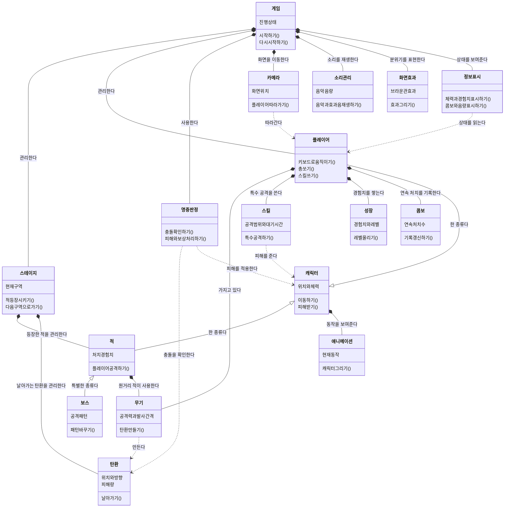

# ONE SHOT ONE KILL — 전체 구조도

게임의 주요 클래스를 한 장에 모은 한국어 설계도입니다. 앞으로 추가할 기능도 포함합니다.

| 문서 | 용도 |
|---|---|
| **전체 구조도 — 현재 문서** | 모든 요소와 관계를 한 장으로 보기 |
| [상세 구조도와 캐릭터 제작 계획](게임_구조도_한국어.md) | 부분별 설명 보기, 규칙 수정하기, 캐릭터 제작 수량 적기 |

**읽는 방법:** 검은 마름모는 소유·관리, 빈 삼각형은 공통 기능을 물려받는 관계, 점선 화살표는 사용 관계입니다. 같은 종류의 적이나 탄환은 여러 개 만들 수 있습니다.

**현재와 목표:** 이동·사격·화면·소리는 구현되어 있지만 대부분 `Stage1Game` 안에 모여 있습니다. 이 그림은 역할을 클래스로 나누고 적 전투·성장·스테이지 진행을 추가한 목표 구조입니다. ‘게임’은 기존 `Stage1Game`, ‘화면효과’는 기존 `CrtEffect`에 대응하며, 흑백 전환은 기존 게임 기반 클래스가 담당합니다. 기반 프레임워크와 리소스 클래스는 생략했습니다.
